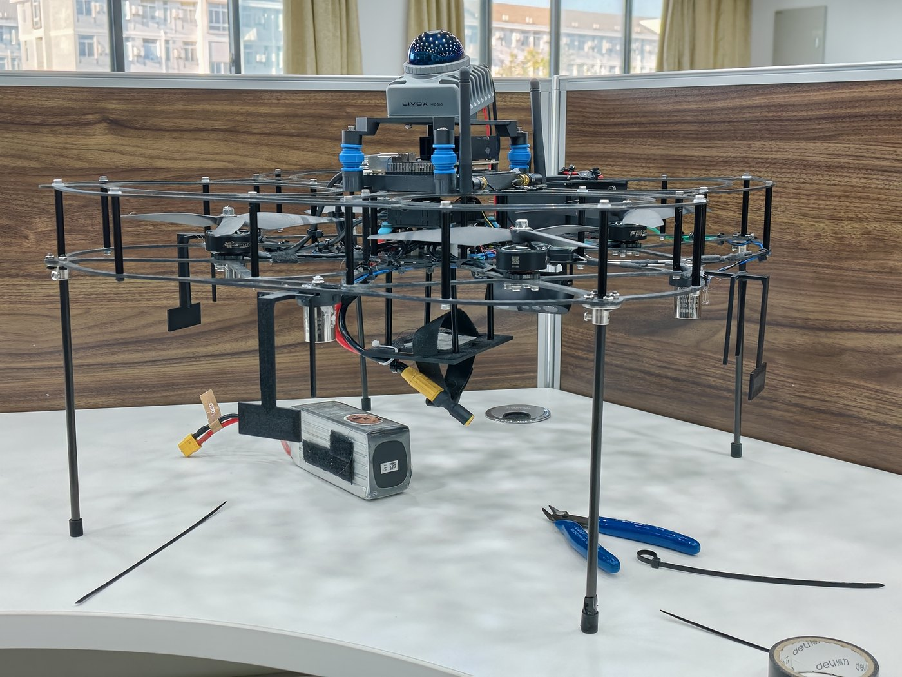

# Autonomous Exploration and Airdrop for UAVs

[](https://docs.ros.org/en/humble/)
[](https://px4.io/)
[](https://www.livoxtech.com/mid-360)
[](https://developer.nvidia.com/embedded)
[](LICENSE)

An autonomous **exploration + vision-guided precision airdrop** system for a PX4 multicopter,
running fully onboard (no GPS, no ground station in the loop) on a Jetson Orin NX.

一套面向**无 GPS 场地**的无人机**自主探索 + 视觉引导精确空投**系统：机载运行（Jetson Orin NX），
由 FAST-LIO（Livox Mid-360）提供里程计与点云，PX4 经 MAVROS 接收位置/速度设定点，
自主探索场地、发现标靶后精确投放、投满后穿越带窄口的走廊返回降落点。

<p align="center">
  
</p>

<p align="center">
  <i>实物平台：Livox Mid-360（顶部，前向倾斜 15°）+ Jetson Orin NX / PX4 机载栈
  + 前视相机（下倾 55°）+ 三路投放机构 + 桨叶保护罩</i>
</p>

---

## Overview 概述

* **Exploration** — 2D occupancy grid (`0.025 m/cell`) built from the LiDAR cloud, frontier-based
  viewpoint selection, A\* planning, B-spline trajectory tracking, and camera-FOV coverage marking.
* **Target handling** — a TensorRT YOLO node publishes ground targets as `geometry_msgs/Point`
  (`/detected_object_class{0,1,2,3,5}`). The exploration node flies to a target, hovers, samples
  the detection (median of N frames), descends, aligns, and triggers a **serial airdrop**.
* **Return & landing** — after the payload is released or coverage is saturated, the aircraft flies to
  a *corner* waypoint, descends to the *corridor height*, crosses a corridor with staggered narrow
  gates (auto-relaxing safety margin), and lands on the far pad.
* **Onboard-only** — the flight controller trusts the LiDAR odometry as its only pose/height source,
  so every height command is expressed in the FAST-LIO world frame.

---

## Key Features 主要功能

| Area | What it does |
|---|---|
| Grid mapping | Incremental occupancy grid, ray-cast free-space update, obstacle inflation (`inflation_radius_dm`) |
| Viewpoint selection | Frontier cells with distance / heading / density scoring, "far-first" priority band, near-point penalty, optional safety filter |
| FOV coverage | Forward tilted camera (`fov_tilt_deg=55`) sector + optional downward ground rectangle, occlusion-aware (rays stop at obstacles) |
| Cloud Z filtering | **Asymmetric bands relative to the current drone height** (explore `+0.10/−0.40 m`, corridor `0.00/−0.20 m`) — robust to LiDAR Z drift |
| Trajectory | A\* + 2D B-spline, speed / acceleration / yaw-rate limits, independent 50 Hz setpoint thread |
| Vision targets | Multi-class priority (`vision_priority_classes=0,1,5`), fallback classes unlocked by exploration progress (`vision_fallback_classes=3,2`, `vision_fallback_pct`), origin rejection (`origin_reject_radius`) to ignore landing-pad "H" marks, duplicate suppression by class and by landed position |
| Precision drop | 3 payload ports with body-frame offsets (`bomb_offsets` / `bomb_offsets_small`), vision baseline point, low-altitude fine alignment, repeated trigger, settle/order checks |
| Corridor return | Corner waypoint → pad A → gate-midpoint detection → A\* mode-1 corridor path with automatic margin relaxation → pad B landing |
| No-return-while-tasking | While a vision task is active the explorer is *not* allowed to start the "coverage reached → go home" behaviour, so an in-flight drop is never aborted |

---

## System Architecture 系统架构

```
        ┌──────────────────────┐    /livox/imu, /livox/lidar
        │ Livox Mid-360 (15°↧) │───────────────┐
        └──────────────────────┘               │
                                               ▼
   ┌────────────┐   /Odometry, /cloud_registered   ┌──────────────┐
   │  FAST-LIO  │──────────────────────────────────▶│ px4_exploration_node │
   └────────────┘                                   │  (this repo) │
                                                    └──────┬───────┘
   ┌────────────┐  /detected_object_class{0,1,2,3,5}      │
   │ YOLO (TRT) │───────────────────────────────────────▶│
   └────────────┘                                         │
                                                          │ setpoint_raw/local (50 Hz)
                                                          ▼
                                                    ┌──────────┐      ┌──────────────┐
                                                    │  MAVROS  │─────▶│     PX4      │
                                                    └──────────┘      └──────┬───────┘
                                                                             │
                                                    ┌────────────────────────▼───────┐
                                                    │ Arduino payload board (serial) │
                                                    │  bomb_0 / bomb_1 / bomb_2      │
                                                    └────────────────────────────────┘
```

### Topics

| Direction | Topic | Type | Note |
|---|---|---|---|
| sub | `/mavros/state` | `mavros_msgs/State` | arming / OFFBOARD supervision |
| sub | `/Odometry` | `nav_msgs/Odometry` | FAST-LIO pose (`position_topic`) |
| sub | `/cloud_registered` | `sensor_msgs/PointCloud2` | FAST-LIO registered cloud (`sensor_topic`) |
| sub | `/detected_object_class{0,1,2,3,5}` | `geometry_msgs/Point` | target ground coordinates |
| pub | `/mavros/setpoint_raw/local` | `mavros_msgs/PositionTarget` | position/velocity setpoints |
| pub/service | `/mavros/cmd/*`, `/mavros/set_mode` | — | arm, OFFBOARD, land |
| serial | `/dev/mcu @115200` | — | airdrop trigger (`bomb_N`) |

---

## Repository Layout

```
.
├── src/
│   ├── px4_exploration/                   # main node: exploration + vision task + return
│   │   ├── src/exploration_main.cpp       # ROS node, state machine glue, vision task, drop
│   │   ├── src/Arduino.cpp                # serial driver for the payload board
│   │   ├── include/px4_exploration/
│   │   │   ├── Px4ExplorationPlanner.hpp  # explorer FSM, viewpoint picking, return/corridor
│   │   │   ├── GridMap.hpp                # occupancy grid + FOV marking
│   │   │   ├── FrontierDetector.hpp       # frontier extraction / update
│   │   │   ├── PathPlanner.hpp            # A* (grid) path planning
│   │   │   ├── BsplineTrajectory2D.hpp    # B-spline path representation
│   │   │   ├── BsplineOptimizer2D.hpp     # trajectory smoothing / constraints
│   │   │   ├── GuiRenderer.hpp            # optional SDL2 map viewer
│   │   │   ├── Arduino.h
│   │   │   └── Types.hpp
│   │   ├── launch/explore.launch.py       # all mission parameters live here
│   │   ├── CMakeLists.txt
│   │   └── package.xml
│   └── serial_drop_test/                  # standalone payload-board test node
├── docs/drone.jpg                         # photo of the experimental airframe
├── README.md
└── LICENSE
```

> This repository contains only the two ROS 2 packages under `src/`
> (`px4_exploration`, `serial_drop_test`). The vision node, FAST-LIO configuration,
> onboard helper scripts and the offline simulator are **not** part of this repo.
> 本仓库只包含 `src/` 下的两个 ROS 2 包；视觉节点、FAST-LIO 配置、机载脚本与离线仿真不在此仓库内。

---

## Hardware 硬件

| Item | Model / note |
|---|---|
| Onboard computer | Jetson Orin NX, Ubuntu 22.04, ROS 2 Humble |
| LiDAR | Livox Mid-360, mounted **tilted 15° downward**, built-in IMU |
| Camera | USB camera, pitched **55° downward**, 1280×720 |
| Flight controller | PX4 (MAVROS 2), height/position reference = LiDAR odometry only |
| Payload mechanism | Arduino board over serial `/dev/mcu @115200`, three release ports |

---

## Software Stack

* ROS 2 **Humble**
* [FAST-LIO 2](https://github.com/hku-mars/FAST_LIO) + `livox_ros_driver2` (odometry & cloud)
* `mavros` / `mavros_msgs` + PX4
* PCL, Eigen
* OpenCV + TensorRT (YOLO) for the vision node
* SDL2 (optional, `use_gui:=1` for the map window)

---

## Build

```bash
# 1) dependencies: ROS 2 Humble + mavros_msgs + PCL
sudo apt install ros-humble-mavros ros-humble-mavros-msgs libpcl-dev

# 2) build this workspace
cd ~/fly_demo
colcon build --base-paths src --packages-select px4_exploration serial_drop_test
source install/setup.bash
```

Only these two packages are built. The vision node is an **external** ROS 2 package
(OpenCV + TensorRT engine of your own model); it just has to publish `geometry_msgs/Point` on
`/detected_object_class<id>`.

---

## Run 运行

```bash
# 1) LiDAR driver + FAST-LIO (separate workspace)
ros2 launch livox_ros_driver2 msg_MID360_launch.py
ros2 launch fast_lio mapping.launch.py

# 2) wait until the odometry Z is stable (important: the aircraft trusts LiDAR Z!)

# 3) exploration + airdrop node
cd ~/fly_demo && source install/setup.bash
ros2 launch px4_exploration explore.launch.py
```

The node takes off, explores, executes vision tasks, then returns and lands autonomously.
Joystick / RC takeover is always possible (switch PX4 to `POSCTL`).

> ⚠️ Bench-test with **propellers removed** first. The node commands OFFBOARD and arming.

---

## Mission Flow 任务流程

```
TAKEOFF ─▶ EXPLORE ─┬─(target detected)─▶ VISION_TASK ─▶ DROP ─┬─▶ EXPLORE (next target)
                    │                                          └─▶ RETURN (payload full)
                    └─(coverage/return requested)───────────────▶ RETURN
RETURN: corner ─▶ descend to corridor_height ─▶ pad A ─▶ corridor gates ─▶ pad B ─▶ LAND
```

Return-leg details:

1. fly to `home_corner_x/y`, settle;
2. descend to `corridor_height` (waits until `corner_h_tol`, bounded by `corner_h_wait_secs`);
3. fly to pad A, align heading to −Y (cloud must cover the corridor walls);
4. detect the gate midpoints from the cloud, plan the corridor path (`ab_path_mode=1`),
   auto-relax `ab_edge_margin` in 0.05 m steps if no path exists;
5. cross the gates at `channel_speed`, then land on pad B.

---

## Key Parameters 关键参数

All parameters are declared in `src/px4_exploration/launch/explore.launch.py`.
The shipped values are the ones tuned on our competition field — **re-calibrate for your airframe**.

### Geometry / heights

| Parameter | Meaning |
|---|---|
| `map_x_min/max`, `map_y_min/max` | occupancy-grid extent (m, LiDAR world frame) |
| `explore_x_min/max`, `explore_y_min/max` | exploration sub-region |
| `takeoff_height` | cruise/exploration altitude |
| `corridor_height` | altitude for pad A → corridor → pad B |
| `drop_height` | release altitude above the target |
| `home_corner_x/y` | return corner waypoint (`-999` = auto: explore-area inset 0.5 m) |
| `pad_a_x/y`, `pad_b_x/y` | corridor entry / landing pad |

### Exploration

| Parameter | Meaning |
|---|---|
| `max_speed`, `max_accel`, `max_yaw_rate` | trajectory limits |
| `edge_margin`, `inflation_radius_dm` | clearance / obstacle inflation |
| `explore_far_first_x` | candidates with `x ≥` this value get priority |
| `explore_pick_topn`, `explore_safe_clear`, `explore_safe_w` | viewpoint safety filter |
| `explore_threshold` | coverage (%) that requests "go home" |
| `fov_tilt_deg`, `fov_divider`, `fov_max_range` | camera FOV coverage model |
| `explore_cloud_h_up/down` | explore-phase cloud Z band **relative to drone height** |
| `ab_cloud_h_up/down` | corridor-phase cloud Z band (relative to drone height) |

### Vision / drop

| Parameter | Meaning |
|---|---|
| `vision_topic_prefix`, `vision_class_list` | target topics / accepted classes |
| `vision_priority_classes` | classes flown first (e.g. `0,1,5`) |
| `vision_fallback_classes` | classes used to fill the quota, unlocked at `vision_fallback_pct` |
| `vision_total` | number of targets to release, then return |
| `vision_lock_yaw`, `vision_near_dist`, `vision_near_hold_secs` | approach behaviour |
| `drop_align_frames`, `drop_try_secs`, `drop_final_tol` | sampling / alignment / tolerance |
| `drop_align_frames` | frames averaged into the vision baseline point |
| `bomb_offsets` | `"x0,y0;x1,y1;x2,y2"` port offsets in the **body frame** (x forward, y left) |
| `bomb_offsets_small` | same, used for small targets (e.g. class 5) |
| `drop_height`, `descent_speed`, `ascend_speed` | release altitude / vertical rates |
| `origin_reject_radius` | ignore class-5 detections within this radius of the take-off origin ("H" mark) |
| `fov_mark_while_vision` | keep marking FOV coverage while executing a vision task |

### Corridor

| Parameter | Meaning |
|---|---|
| `ab_edge_margin` | required edge clearance for the corridor plan (auto-relaxed if no path) |
| `ab_path_mode` | `1` = gate-centred axis-aligned path, `0` = conservative A\* |
| `channel_speed` | corridor cruise speed |
| `corner_h_tol`, `corner_h_wait_secs` | "reached corridor altitude" tolerance / timeout |

---

## Vision Interface 视觉接口

The exploration node consumes target detections from an external vision node
(TensorRT YOLO, OpenCV), which only has to publish `geometry_msgs/Point` in the odometry frame.
**The vision implementation is not included in this repository.**

* inference at ~10 Hz, detections filtered by `conf_threshold`, class, depth consistency and
  image-border contact;
* ground projection: pixel ray → camera → **radar/IMU frame** (`R_CAM_TO_RADAR`, `T_CAM_IN_RADAR`)
  → intersect with the calibrated ground plane `z = ground_z`;
* publishes `geometry_msgs/Point` in the **odometry (LiDAR world) frame**;
* tunable offsets: `cam_offset_x/y/z`, `cam_offset_x_small` (small-target variant);
* does not publish below a configurable altitude so that the descent phase relies on the
  baseline point sampled at cruise altitude.

---

## Payload / Serial Protocol

* Port: `serial_port` (default `/dev/mcu`), `serial_baud` 115200, `serial_ready_secs` guard after open.
* Commands: `bomb_0`, `bomb_1`, `bomb_2` (ASCII lines), repeated `drop_repeat` times.
* Port assignment follows the visit order: 1st drop → port 0, 2nd → port 1, 3rd → port 2.
* `serial_drop_test` package lets you exercise the board standalone.

---

## Notes & Limitations 已知问题

* **LiDAR Z drift** — under propeller vibration the FAST-LIO Z drifts slowly (measured ≈5–7 mm/min
  when static; much worse before initialization converges). Because PX4 trusts the LiDAR, this maps
  1:1 into real altitude error. Always let the odometry settle before starting the mission.
* **Mount tilt** — the LiDAR is mounted 15° downward; the corresponding `extrinsic_R` is set in the
  FAST-LIO yaml and `extrinsic_est_en` is disabled to avoid the online estimator fighting the
  configured mount.
* **Frontier option A** — cells already covered by the camera FOV are excluded from frontiers, which
  avoids re-visiting explored areas but lowers the reported coverage percentage.
* **Unreachable targets** — if a target lands inside an obstacle's inflation zone, the approach keeps
  replanning; take over manually if the aircraft hovers.
* **Moving people** — referees walking through the field leave phantom obstacles in the grid.
* **Airdrop accuracy** — port offsets (`bomb_offsets`) and the vision offsets (`cam_offset_*`) must be
  calibrated per airframe; the values shipped here are field-tuned for one specific vehicle.

---

## License

[MIT](LICENSE)

## Contributors

- **aaalixin** — design, implementation, field integration and flight testing.
